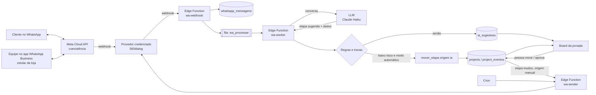

# Arquitetura: WhatsApp + IA no board da jornada

Documento de decisão antes de construir. Base: pesquisa de 13/10/2026 (`reports/Integração WhatsApp jornada do cliente.md`)
e o que já está em produção (board da jornada, migrações `20261016120000` e `20261017120000`).

## 1. Objetivo

O board da jornada se atualiza sozinho a partir das conversas de WhatsApp da loja:

- toda mensagem de cliente e toda resposta da equipe entram no histórico do card;
- os relógios (esperando resposta, follow-up, esfriando) passam a ser reais, sem ninguém clicar "Já respondi";
- número novo que chama vira card em **Novo contato**;
- uma IA lê a conversa, **sugere** a etapa certa e extrai dados (nome, ambiente, data da visita); com o tempo, passa a **aplicar** sozinha só os movimentos de baixo risco;
- follow-ups de orçamento (D+1/D+3/D+7) saem pelo WhatsApp oficial.

Fora do escopo: a IA conversar com o cliente no lugar da equipe (isso continua com a equipe ou com a IA da Meta no app, ver §3).

## 2. Princípios

1. **Só caminho oficial da Meta.** APIs não oficiais (Z-API, Evolution) arriscam o banimento do número que sustenta as vendas.
2. **O celular da loja continua funcionando** como hoje (coexistência).
3. **A IA nunca fala com o cliente e nunca dispara mensagem por conta própria.** Ela só sugere/move etapas de venda e registra.
4. **Fechamento e execução são sempre humanos.** A IA não move para Fechado, Pré-produção, Produção, Instalação ou Concluído.
5. **Tudo auditável:** todo movimento tem origem (`manual` / `whatsapp` / `ia`), motivo e evidência. ✅ *já em produção após a migração `20261017120000`*.
6. **Desligável por empresa** a qualquer momento (kill switch), sem quebrar o board.

## 3. Decisões

| # | Decisão | Escolha | Situação |
|---|---|---|---|
| D1 | Como conectar o número | WhatsApp Cloud API em **coexistência**, via provedor credenciado (360dialog: ~US$ 59/mês por número) | Aprovar com o Igor |
| D2 | Arquiteck como Tech Provider da Meta (zera a mensalidade do provedor) | Avaliar na Fase 5; requisitos ainda não pesquisados | Aberto |
| D3 | IA da Meta que o Igor usa no app | Manter se sobreviver à coexistência; **decidido pelo teste da Fase 1** | Aberto (teste) |
| D4 | Modelo de IA para classificar | Claude Haiku (custo ~R$ 1–15/mês), saída estruturada; Sonnet só se a qualidade pedir | Proposta |
| D5 | Aviso ao cliente quando muda a etapa (hoje: navegador → n8n) | Sai do navegador: vira envio pelo servidor, por **template utility aprovado** na API oficial, só para movimentos com origem `manual` | Proposta |
| D6 | Follow-up de orçamento | D+1 dentro da janela de 24h = texto livre (grátis); D+3/D+7 = template (provavelmente marketing, ~R$ 0,32/msg), **sempre aprovado por uma pessoa no card** antes de sair | Proposta |
| D7 | Opt-in / opt-out | Cliente que escreve para a loja autoriza resposta; follow-up só com opt-in registrado; "parar"/"não quero" marca opt-out e bloqueia envios | Proposta |

## 4. Visão geral

## 5. Modelo de dados

O que **já existe** e é reaproveitado:

- `projects`: `status` (9 etapas), `etapa_desde`, `ultimo_contato_cliente_at`, `ultimo_contato_nosso_at`, `proximo_followup_at`.
- `project_eventos`: histórico imutável, com `origem` e `mensagem`.
- `mover_etapa(projeto, etapa, origem, motivo)`: único caminho para gravar movimentos `ia`/`whatsapp`, e só pelo servidor.

O que **entra** (migração da Fase 2/3):

| Tabela / coluna | Para quê |
|---|---|
| `whatsapp_contas` (tenant, `phone_number_id`, `waba_id`, provedor, nome do segredo no Vault, ativo) | Liga o número da Meta à empresa (multi-empresa). O token fica no **Supabase Vault**, nunca na tabela. |
| `whatsapp_mensagens` (`wa_message_id` **único**, tenant, `client_id`, `project_id`, direção entrada/saída, autor `cliente` / `equipe_app` / `sistema`, tipo texto/áudio/imagem, texto, caminho da mídia no Storage privado, enviada_em, `raw` jsonb) | Espelho das conversas. O `wa_message_id` único garante que reenvio da Meta não duplica nada. |
| `clients.telefone_e164` (gerada a partir do telefone, única por tenant) | Achar o cliente pelo número que chegou, sem depender da máscara "(31) 9…". |
| `clients.opt_in_em`, `clients.opt_out_em` | Base legal e regra da Meta para follow-up. |
| `ia_config` (tenant, modo `desligada` / `sombra` / `sugestao` / `automatica`, limites) | Kill switch e evolução gradual por empresa. |
| `ia_sugestoes` (projeto, etapa sugerida, confiança, ids das mensagens de evidência, dados extraídos, status `pendente` / `aceita` / `recusada` / `aplicada`, quem decidiu) | Caixa de aprovação no board e base para medir a precisão da IA antes de deixá-la aplicar. |
| `whatsapp_envios` (projeto, tipo `aviso_etapa` / `followup`, template, status, erro, agendado_para, aprovado_por) | Fila e registro de tudo que o sistema manda ao cliente. |

Tudo com RLS por tenant, no padrão da fase 15. A Edge Function usa a chave de serviço, mas sempre grava o `tenant_id` vindo de `whatsapp_contas`.

## 6. Fluxos

### 6.1 Mensagem do cliente chega
1. `wa-webhook` valida a assinatura `X-Hub-Signature-256` (HMAC do corpo cru) e responde 200 **depois** de gravar.
2. Grava em `whatsapp_mensagens` com `ON CONFLICT (wa_message_id) DO NOTHING`.
3. Acha o cliente por `telefone_e164`. Número novo → `criar_lead` (card em **Novo contato**, origem `whatsapp`).
4. Atualiza `ultimo_contato_cliente_at` e grava evento `mensagem` com o texto (aparece no card e na linha do tempo).
5. Enfileira o projeto para análise.

### 6.2 Equipe responde pelo celular (echo da coexistência)
`smb_message_echoes` → grava como saída, autor `equipe_app`, atualiza `ultimo_contato_nosso_at`. **O relógio "Precisa responder" para sozinho.**
Limitação: respostas pelo **WhatsApp para Windows** não geram aviso (não suportado na coexistência).

### 6.3 Análise pela IA (`wa-worker`)
1. Espera a "rajada" do cliente terminar (ex.: 2 min sem mensagem nova) para não analisar frase por frase.
2. Áudio → transcrição (OGG/OPUS) antes da análise. Mídia copiada para o bucket privado na hora (a URL da Meta expira em 5 min).
3. Manda ao LLM: etapa atual, últimas N mensagens, dados do card. Resposta em JSON com esquema fixo: etapa sugerida, confiança (`alta` / `media` / `baixa`), ids das mensagens de evidência, dados extraídos, opt-out detectado.
4. Aplica as travas (§7). Passou → `mover_etapa(..., 'ia', motivo)`. Não passou → `ia_sugestoes` pendente.
5. Erro de LLM ou de formato → tenta de novo; após N tentativas vai para uma tabela de falhas. Nunca trava a fila.

### 6.4 Aviso ao cliente na mudança de etapa (substitui o n8n)
Gatilho em `project_eventos` (tipo `etapa`, origem **`manual`**, etapa que avisa o cliente) → `whatsapp_envios` → `wa-sender` manda o **template utility** aprovado.
Movimentos da IA ou do WhatsApp **nunca** geram aviso. De quebra, a URL do n8n sai do código do app (hoje fica exposta no navegador).

### 6.5 Follow-up de orçamento
Cron diário em horário útil → projetos em **Orçamento enviado** com `proximo_followup_at` vencido e opt-in, sem opt-out → aparece no card como **"follow-up pronto, revisar e enviar"**. A pessoa aprova com um clique → `wa-sender`. Dentro da janela de 24h vai como texto livre (grátis); fora dela, como template.

## 7. Regras e travas da IA

| Regra | Valor inicial |
|---|---|
| Modo inicial de toda empresa | `sombra`: a IA só grava sugestões, ninguém vê; serve para medir a precisão |
| Etapas que a IA pode aplicar | Novo contato → Em conversa → Visita/Briefing → Orçamento enviado |
| Direção | Só para frente, **um passo por vez** |
| Etapas proibidas para a IA | Fechado, Pré-produção, Produção, Instalação, Concluído (e voltar etapa) |
| Confiança mínima para aplicar | `alta` + evidência conferida (os ids citados existem e são do cliente) |
| Frequência | No máximo 1 movimento da IA por card a cada 24h |
| Card mexido por pessoa nas últimas 24h | A IA não move, só sugere |
| Opt-out detectado | Marca o cliente e avisa a equipe; nunca move |
| Passagem para `automatica` | Só depois de ≥ 2 semanas em `sugestao` com ≥ 90% de sugestões aceitas |

## 8. Segurança, Meta e LGPD

- **Webhook:** `verify_jwt = false` (a Meta não manda JWT do Supabase), proteção feita pela assinatura HMAC. Deduplicação pelo id da mensagem (a Meta reenvia por até 7 dias).
- **Segredos:** token da Meta/provedor e chave do LLM no Supabase Vault / segredos de Edge Function.
- **Política da Meta (§4.7, desde 15/01/2026):** proíbe provedores de IA de propósito geral; IA usada pela própria empresa no seu atendimento é permitida. Exige caminho claro para falar com uma pessoa, respeito ao opt-out, e proíbe treinar modelos com as conversas ou cruzar dados entre empresas.
- **LGPD:** a Primor é controladora, o Arquiteck é operador. Enviar conversas a um LLM nos EUA é transferência internacional; vale contrato com as cláusulas-padrão da ANPD (obrigatórias desde 23/08/2025). Usar API com retenção zero/sem treinamento. Definir prazo de retenção das mensagens (proposta: 24 meses) e exclusão junto com o cliente.
- **Transparência:** o cliente da loja pode pedir revisão de decisão automatizada. Como a IA não decide nada que afete o cliente diretamente (só organiza o board interno), o risco é baixo, mas fica registrado.

## 9. Custos mensais estimados (Primor)

| Item | Valor |
|---|---|
| Provedor credenciado (360dialog) | ~R$ 296 (zera se o Arquiteck virar Tech Provider) |
| Supabase Pro | ~R$ 125 |
| IA de classificação (Claude Haiku) | R$ 1 a 15 |
| Transcrição de áudio | R$ 2 a 10 |
| Templates Meta (avisos utility + follow-ups marketing) | R$ 10 a 80 no volume atual |
| **Total** | **~R$ 430 a 530** com provedor; **~R$ 140 a 230** como Tech Provider |

Ponto em aberto da pesquisa: se as respostas livres dentro da janela passaram a ser cobradas desde 01/10/2026 (fontes divergem). Na coexistência o impacto é de R$ 0 a 70/mês, porque o que a equipe responde pelo app é sempre grátis.

## 10. Fases e critério para avançar

| Fase | Entrega | Critério para a próxima |
|---|---|---|
| 0. Levantamento | Com o Igor: volume real, quem responde e de onde (celular? Windows?), se usa Meta Verified, se faz disparos por lista, exemplos de conversas | Respostas registradas neste documento |
| 1. Teste de coexistência | Número secundário, 1 semana: a IA da Meta continua? os echoes chegam? o que some no app? | Decisão D3 tomada |
| 2. Espelho | Webhook + mensagens no card + relógios automáticos + leads automáticos. **Sem IA**. Aviso de etapa migrado do n8n | 2 semanas sem mensagem perdida/duplicada |
| 3. IA sugerindo | Worker + LLM em modo `sombra` e depois `sugestao`, com caixa de aprovação no board | ≥ 90% das sugestões aceitas |
| 4. IA aplicando | Modo `automatica` só para os movimentos de baixo risco + follow-ups com aprovação | Igor satisfeito, sem movimento errado relevante |
| 5. Escala | Arquiteck como Tech Provider, onboarding de novas marcenarias pelo próprio app | — |

## 11. O que precisa de resposta antes da Fase 2

1. **Igor topa a coexistência e o custo do provedor** (~R$ 296/mês) enquanto o Arquiteck não for Tech Provider? (D1)
2. **Número para o teste** da Fase 1: existe um segundo chip/número com WhatsApp Business antigo? (contas novas não entram em coexistência na hora)
3. **Quem paga o quê**: mensalidade do provedor, Supabase e templates ficam na conta da Primor ou do Arquiteck?
4. **O que o n8n usa hoje para mandar WhatsApp?** Se for API não oficial, o número já está em risco e a migração para o oficial (D5) vira prioridade.
5. **A equipe responde pelo WhatsApp para Windows?** Se sim, essas respostas não chegam ao board; precisa trocar por WhatsApp Web ou celular.
